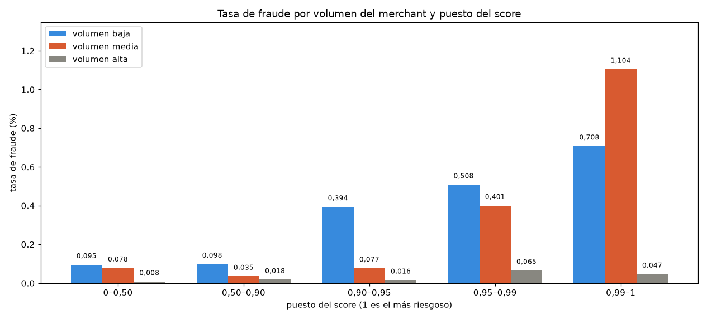
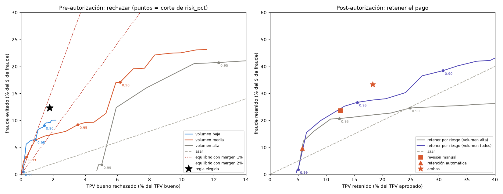
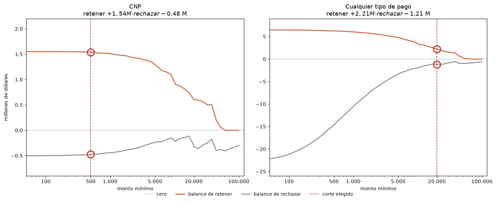

# Project decisions

Each decision records the question, what we know, the options, how the choice is made, and what was decided.

---

## 1 · Target: how we built it from `is_suspended`

**Question.** The model ranks active merchants: which ones look like those a review ends up suspending? It returns a ranking, not the probability that a suspension falls within a window.

`is_suspended` is the daily state, not an event. Building the target means deciding who is included and which day of each merchant is used.

### What we know

Source: `notebooks/02_suspensiones.ipynb`, `docs/suspensiones.png`, `docs/suspensiones_dia_a_dia.md`, `docs/variables/`.

| Fact | Value |
| --- | --- |
| Merchants ever suspended | 26 |
| With an observed start (an active day followed by a suspended day) | 19, each with a single start |
| With no observed start | 7: 3 are already suspended on Apr 1 (first day of data); 3 appear already suspended, for 1 day, and go back to operating; 1 (`MEBF6C9…`) has 153 days of null state before its suspension |
| Length of the suspension (the 19) | from 1 to 92 days |
| Return to operating | 19 of 26 |
| Labeled period | April–September; in October–December `is_suspended` is 100% null |

How the 19 starts look day by day (a reading of the charts; it is an interpretation on few cases):

| Pattern | Merchants | What it implies |
| --- | --- | --- |
| Burst of attempts and a drop in approval 1 to 3 days before the start | ~7 | There is a signal, but with very little lead time |
| Declines only on the row of the first suspended day | ~4 | That is previous-day activity, before the suspension: there are no declines caused by the suspension |
| Nothing unusual before (almost no activity, or just onboarded) | ~8 | Their behavior does not anticipate the suspension |

Other facts that weigh on the decision:

- Several suspensions fall on the same day (4 on Aug 23, 2 on Sep 11, 2 on Apr 22): they look like batch reviews.
- Suspended merchants operate very little: from 0 to 2 transactions a day.
- While the merchant is suspended, their features reflect the suspension (volume at zero; there are no declines caused by the suspension).

### Decision 1a · Which cases are included

**Classification of the 19 observed starts** by behavior before the suspension. It is a reading of the charts in `docs/suspensiones.png` and `docs/variables/` (from 30 days before to 10 after), not an automatic rule. Variables that do not move before the start were dropped earlier: network, open platform / pocket / recurring / SPEI channels, flags, MCC, claims, and chargebacks. Industry percentiles describe the industry, not the merchant.

| Group | Merchant | Start | What is visible before | Included | Reason |
| --- | --- | --- | --- | --- | --- |
| **A · Deterioration over days or weeks** | `MA52FE20E571E5DCA` | Jul 15 | Ticket from 5,000 to 12,000, rising volume, TPV approval from 90% to 27% in 3 weeks | Included | Visible deterioration before the start |
| | `M2971A5DEEED25520` | Aug 23 | 30-day attempts from 10 to 90 in a month, TPV approval near 0 | Included | Visible deterioration before the start |
| | `M331E694E1EECD91A` | Aug 23 | Attempts growing continuously; on day −7 the ticket doubles and approval falls to 75% | Included | Visible deterioration before the start |
| | `MB351DC99D4064375` | Apr 22 | Approval ~10%; jump in attempts on day −10 | Included | Visible deterioration before the start |
| | `MC45B94C90F7E27CD` | Jul 25 | Approval ~30% at 30 days; on Jul 4 (day −21) 9 attempts and 7 declined | Included | Visible deterioration before the start |
| | `M46B66AE0E309595B` | Jun 14 | Appears 4 days before and goes from 4 to 43 attempts with falling approval; 256 frauds in transactions | Included | Visible deterioration before the start |
| **B · Short burst of declines 1 to 3 days before** | `MB2ECDC9763AB4E54` | Aug 23 | Spike in attempts and approval from 100% to 44% on days −2 and −1 | Included | A burst of declines before the start |
| | `MEB47BBD227407EA5` | Aug 23 | 6 declined attempts on day −1 | Included | A burst of declines before the start |
| | `MFECEBCA0010F3873` | Apr 22 | Declined attempts on day −1, ticket jumps to 5,500 | Included | A burst of declines before the start |
| | `M7F9108A69784504E` | Apr 29 | On Apr 26 (day −3) 3 attempts, all 3 declined, ticket ~17 | Included | A burst of declines before the start |
| **C · New merchant, everything happens on day 0** | `MF6C1EBC5EE0342DB` | May 29 | Appears on day −1; their network adds one suspended merchant on day 0 | Included | The attempts are on the snapshot row |
| | `MED4E6F81B6D71742` | Jul 1 | First online transaction, of 10,000, declined | Included | The attempts are on the snapshot row |
| **D · No visible risk before** | `MEA1EE5CA0A25553F` | Sep 12 | New account (12 days), 0 lifetime transactions | Left out | Never operated |
| | `M002D3A13420843D9` | Apr 7 | Only 6 days of history (the data starts on Apr 1) | Left out | Left-censored: the history starts with the dataset |
| **Out of the analysis** | `ME9BD50FCE697D4A7` | Jun 25 | Normal approval history, then silence. Does not count as a case | Left out | Normal approval and then silence: no activity to learn from |
| | `MF000975FCCCF8010` | Sep 11 | Tenure 0, one transaction of about 1 peso. Does not count as a case | Left out | One transaction of about 1 peso, no suspicious activity |
| | `M486B452BBACA6CA4` | Sep 11 | Almost inactive: two online transactions of ~3,000, approved. Probably suspended by the merchant. Does not count as a case | Left out | Almost inactive and approved transactions; likely a self-suspension |
| | `M3182C56E1D13EC33` | Sep 24 | Did nothing unusual. Suspended for another reason. Does not count as a case | Left out | No suspicious activity |
| | `M315DBFD11714A6D5` | Sep 30 | Before the block: 1 to 3 attempts a day, all approved, and 4 days with no activity. No suspicious activity. Claims (monthly) jump on Oct 1, from 0 to 17 | Left out | No suspicious activity; the claims jump is the monthly update |

### Decision 1b · How was the target built?

Each merchant has one row per day. The model sees **only one**: the snapshot. On that row, **positive** is `target = 1` and **negative** is `target = 0`.

**Positive (`target = 1`): the first suspended day of one of the 12 who are included.** The company confirmed that the row dated *t* summarizes activity through the previous day, and that a suspended merchant cannot transact. The numbers on that row are therefore those of the last day they were still operating. There are no declines caused by the suspension.

Using the day before would drop that last day: that row summarizes activity from two days earlier. The day is also not chosen by looking at which row has more declines. With this rule, the snapshot shows the 7 declines of `M46B66A`, the 15 of `MA52FE2`, the 6 of `MB351DC`, and the attempts of `MED4E6F` and `MF6C1EB`.

The untrained rule looks at three things on that snapshot and keeps the worst: approval between 7 and 30 days, the declines on the snapshot itself, and the worst day of declines in the 30 days ending on the snapshot. That peak is what reaches `MC45B94` (7 declines on Jul 4, 21 days before) and `M7F9108` (3 declines on Apr 26, 3 days before).

**Negative (`target = 0`): a merchant who was not suspended between April and September, on a day they were active.** The date is drawn with the same mix of days as the positive snapshots (seed 0), so the calendar does not become the signal. August weighs a bit more among the negatives because that month has more merchants with a row. If a merchant has no active day on those dates, they stay out: 6,739 of the 40,239 who were never suspended. 33,500 come in.

**The rest of the history is not used.**

- Days after the first suspended day: the merchant is already blocked and the features show volume at zero.
- Days with a null state.
- October to December: the labels for that period are hidden.
- Days before the snapshot, as extra rows of a healthy merchant. If on one of those days the merchant already looked bad and we labeled them negative, the model would learn that profile is healthy.

---

## 2 · Validation: how train and test are split

The split is a 5-fold `StratifiedKFold`, repeated with 10 seeds (`notebooks/05_logistica.ipynb`). Each merchant is predicted by a model trained without them. There is one row per merchant, so the train and test of a fold share none. It is repeated with several seeds because a single split leaves the test with about 2 or 3 positives (`target = 1`), out of 12, and with so few the ranking changes with the split.

The metric is the ranking on the test: PR-AUC and recall in the top 1% and 5%. At that test size the number is noisy.

The same split is used to compare the variable sets. Which one was chosen is in section 3.

---

## 3 · Features: which ones are built and which ones enter the model

The steps below say how those columns were chosen.

### Step 1 · Out by definition

| Column | Reason |
| --- | --- |
| `me_merchant_created_at_timestamp` | A date; tenure is already in `merchant_tenure_days` |
| `config_segment` | 100% null |
| `me_attempted_pocket_txn_sum_7d` | A single value in the whole dataset |
| `me_industry_mcc` | Equal to `industry_mcc` on 99.7% of rows. `industry_mcc` stays at this step and leaves later, with the rest of the raw industry |
| `vip0_segment` | Non-null exactly where `is_veto_vip0` is non-null: it repeats the flag |
| `me_suspended_merchants_in_network`, `me_suspended_merchants_in_network_share` | Leakage: they rise just when the merchant themselves is suspended and fall when they return |
| `is_closed_won_ever`, `is_veto_vip0`, `is_veto_config`, `is_portfolio_managed` | 97–99% null in that measurement; almost no positive (`target = 1`) had a value |
| `me_lifetime_chargeback_tpv`, `me_lifetime_dispute_tpv` | 97–99% null in that measurement; almost no positive (`target = 1`) had a value |
| `me_network_size`, `me_network_avg_tpv_approval_rate` | Only 2 to 4 suspended merchants have a network. Not enough to measure |
| `me_network_avg_tpv_chargeback_rate`, `me_network_avg_tpv_dispute_rate` | Almost no values among the suspended |
| `me_attempted_openplatform_txn_sum_7d`, `me_attempted_recurring_txn_sum_7d`, `me_attempted_spei_txn_sum_7d` | The open platform, recurring, and SPEI channels have almost no values among the suspended |
| `ratio_claims_tpv_180d` | Almost no values among the suspended |

### Step 2 · What moves as the suspension approaches

This looks for features that change in the days before the suspension. For each one, the median of the 13 positives in that measurement is followed from 60 days before through the day before, and compared with the usual range (25th to 75th percentile) of merchants who were never suspended. If the median leaves that range as the day approaches, the feature moves.

| Reading | Features |
| --- | --- |
| **Move as the suspension approaches** | Approval rates (by transaction and by TPV, at 1, 7, 15, and 30 days): they fall below the normal range in the last ~20 days, more strongly near day −1 (at 7 days, from ~100% to 30–50%). Average ticket at 7 and 30 days: above the range and rising. Attempts at 7, 15, and 30 days: rise at the end, though still inside the normal range |
| **Different in level, but they do not move** | Lifetime approval (`me_lifetime_*_approval_rate`: 0.6–0.7 against a normal 0.9) and lifetime ticket. They describe what the merchant is like, not a change |
| **No signal** | Approved transactions (1, 7, 15, 30, and 90 days), approved TPV |
| **No variation and no data on the positives** | `me_attempted_openplatform_txn_sum_7d`, `me_attempted_recurring_txn_sum_7d`, `me_attempted_spei_txn_sum_7d`, `me_network_avg_tpv_chargeback_rate`, `me_network_avg_tpv_dispute_rate`, `ratio_claims_tpv_180d`, `is_*` flags, accumulated chargebacks and disputes (only 1 positive has data) |
| **Describe the industry, not the merchant** | `industry_mcc`, `ind_*`, and `p*_approved_*_90d` percentiles: their jumps come from which merchants enter the median |
| **Noise or artifact** | `merchant_tenure_days` (jumps with no meaning), `me_network_size` and `me_network_avg_tpv_approval_rate` (only 4 positives have a network; the jump at the end is one merchant entering) |
| **The median does not work** | `me_attempted_ecommerce_txn_sum_7d`: most values are 0, so the median hides the few who do have ecommerce. It has to be read with the share of merchants with a value > 0 |

### Step 3 · What the model can use: the change, or what the merchant is like

This was done to choose what to look at. There were two possibilities. One: the merchant gets worse in the month before the suspension, so the change has to be measured. The other: they were already different from those who are never suspended, so the snapshot is enough.

The previous step looked at the charts day by day. Here the month just before the suspension is compared with the month before that, and with 3,000 merchants who were never suspended, given a random date so the same calculation can be made. There were few cases: 7 with enough history to see whether they changed, and about 11 with data in the prior month. With so few, the numbers are for sorting the ideas.

- **The change.** Among the 7 with enough history, no variable changes strongly from one month to the next. Approval falls, but less than the charts suggested: the drop is in the last days and a 30-day average hides it. In group A that deterioration had already started in the earlier month.
- **What the merchant is like.** In the prior month, those who were suspended approve less than the others, both recently and over their whole history. They also move higher amounts and have somewhat more attempts.

The measurement decided what not to build. There is no variable for "how much they changed relative to themselves": from one month to the next that change does not show up, and a 30-day average hides the drop in the last days. What the snapshot does carry is the difference against the others: they approve less and move higher amounts. That is why the model looks at the merchant's level on that day, not at their change.

### Funnel

The panel has 71 columns. Three are not features: `merchant_id`, `observation_date`, and `is_suspended`. The funnel starts with the other 68, leaves 25 in `features.parquet`, and trains on 4 of those.

| Step | What leaves | Out | Left |
| --- | --- | --- | --- |
| Panel | — | — | 68 |
| 1. By definition | The 21 in the table above: date, empty, duplicated, leakage, flags, chargebacks, network, channels with no data, and claims | 21 | 47 |
| 2. Raw industry | `industry_mcc`, the `ind_*`, and the `p*_` percentiles. With 13 suspended merchants the model would learn the category. 3 new columns come in: the merchant against their own industry | 15 | 35 |
| 3. Approved counts that do not separate | Approved counts and TPV (`me_approved_txn_sum_*`, `me_approved_tpv_sum_30d`, `approved_txns_90d`, `me_lifetime_approved_tpv`). Size stays in two columns | 7 | 28 |
| 4. Channel and tenure | Where the merchant came from (3) and `merchant_tenure_days`, which jumps when the month changes and does not describe the day | 4 | 24 |
| 5. Decline peak | `max_rechazos_1d_30d` comes in: the worst day of declines in the 30 days up to the snapshot. The list is below | — | 25 |

Step 5 leaves these 25, which are the ones in `features.parquet`:

| Group | Features |
| --- | --- |
| Current approval (8) | `me_txn_approval_rate_1d`, `_7d`, `_15d`, `_30d`; `me_tpv_approval_rate_1d`, `_7d`, `_15d`, `_30d` |
| Lifetime approval (2) | `me_lifetime_txn_approval_rate`, `me_lifetime_tpv_approval_rate` |
| Ticket (4) | `me_attempted_tpv_avg_1d`, `_7d`, `_30d`; `me_lifetime_tpv_avg` |
| Attempts (4) | `me_attempted_txn_sum_1d`, `_7d`, `_15d`, `_30d` |
| Ecommerce (1) | `me_attempted_ecommerce_txn_sum_7d` |
| Size (2) | `approved_tpv_90d`, `me_lifetime_approved_txn` |
| Against their industry (3) | `tpv_vs_industry_p50`, `tpv_vs_industry_p95`, `txns_vs_industry_p50` |
| Decline peak (1) | `max_rechazos_1d_30d` |

From those 25, discarding continues:

| Step | What leaves | Out | Left |
| --- | --- | --- | --- |
| 5 | The 25 above | — | 25 |
| 6. Repeated approval | The 8 rates and the lifetime TPV rate say the same thing. The 1-day rate is almost always empty, the 15-day rate sits between 7 and 30, and the TPV rates move with the transaction rates. What remains is the 7-day rate, the 30-day rate, and lifetime approval by transaction | 7 | 18 |
| 7. Ticket and attempts | They were tried on top of approval and the peak. PR-AUC rises from 0.022 to 0.023 and the top 5% falls from 10.6 to 9.9, with more variation across splits. They do not enter | 8 | 10 |
| 8. Ecommerce, size, and industry | With 12 positives, extra columns that separated little in the reading. They do not enter | 6 | 4 |

With 12 positives the model is not trained on the 25: several tell the same story. What matters, from step 3, is that the merchant approves less than the others and had a day with many declines. That is why the training set is approval (the worse of 7 and 30 days, plus lifetime), a flag for whether there was activity at 7 days, and the decline peak. That set puts 10.6 of the 12 in the top 5%. Approval alone reaches 8.3.

Four columns remain, and those build the four that train:

| Trains | How it is built |
| --- | --- |
| `aprobacion_7d` | The minimum of `me_txn_approval_rate_7d` and `_30d`. If both are missing, `me_lifetime_txn_approval_rate` |
| `aprobacion_historica` | `me_lifetime_txn_approval_rate` |
| `sin_actividad_7d` | 1 if `me_txn_approval_rate_7d` is null |
| `log_max_rechazos_30d` | The log of `max_rechazos_1d_30d` |

---

## 4 · Modeling

The 25 columns are turned into three sets and compared with the split from section 2 (`notebooks/05_logistica.ipynb`).

| Set | Variables | PR-AUC | Top 5% (of 12) |
| --- | --- | --- | --- |
| A | `aprobacion_7d` | 0.0060 | 8.3 |
| **B, the one chosen** | A + `aprobacion_historica` + `sin_actividad_7d` + `log_max_rechazos_30d` | 0.0216 | 10.6 |
| C | B + `log_ticket_30d` + `log_intentos_7d` | 0.0234 | 9.9 |

C raises PR-AUC and captures fewer positives in the top 5%, with more spread across seeds. B stays.

| Variable in B | Definition |
| --- | --- |
| `aprobacion_7d` | Minimum of the transaction approval rate at 7 and at 30 days. If both are missing, lifetime approval by transaction |
| `aprobacion_historica` | `me_lifetime_txn_approval_rate` |
| `sin_actividad_7d` | 1 if the 7-day rate is null |
| `log_max_rechazos_30d` | Log of `max_rechazos_1d_30d` |

### Results

Join source: `notebooks/06_transacciones_con_score.ipynb`. The score comes from logistic B, on the Oct 1 row.

The rank goes from 0 to 1. **1 is the most risky.** Here the October–December transactions are read by that rank, to see whether fraud sits near 1. The table is in `docs/score/riesgo_por_tramo.csv`.

| Rank (`risk_pct`) | Merchants | % of transactions | % of money | % of frauds | Approval | Fraud rate |
| --- | --- | --- | --- | --- | --- | --- |
| 0–0.50 | 20,132 | 6.1% | 17.0% | 13.4% | 89.5% | 0.081% |
| 0.50–0.90 | 16,106 | 55.5% | 49.2% | 37.5% | 94.3% | 0.025% |
| 0.90–0.95 | 2,013 | 24.4% | 14.9% | 13.3% | 93.7% | 0.020% |
| 0.95–0.99 | 1,611 | 11.7% | 12.8% | 29.5% | 92.2% | 0.093% |
| 0.99–1, the top 1% | 403 | 2.4% | 6.1% | 6.3% | 86.2% | 0.098% |
| **0.95–1, sum of the two above** | **2,014** | **14.1%** | **18.9%** | **35.8%** | | |

The rate does not fall steadily toward 0. In 0–0.50 there are merchants with very few transactions (median of 5, against 60 in the rest; 37% have between 1 and 3), and one fraud moves their rate. In 0.95–0.99, `M46B66AE0E309595B` has 256 of the 767 frauds; without them the rate goes from 0.093% to 0.062%. The score was trained on suspensions, and of the 26 suspended merchants only 1 had a lot of fraud. That is why the rules in section 5 do not look at rank alone: they cross it with the merchant's volume.

---

## 5 · Pre- and post-authorization rules

Source: `notebooks/07_reglas.ipynb`.

The October–December transactions were not used for training: impact is measured there. Volume is the number of attempts in the 30 days through Sep 30: no activity, low 1–9, medium 10–99, high 100 or more. Assumptions that are not in the data: a Clip margin of 1% of TPV, and a 7-day hold.

A decline requires an equilibrium (fraud dollars avoided / good TPV declined) of at least 1.5%. The cuts are in `tabla_de_cortes.csv`.

### Pre-authorization

Low volume with risk ≥ 0.90 is declined, or medium volume with risk ≥ 0.99. High volume is not declined.

| Volume | Cut | Equilibrium | Decision |
| --- | --- | --- | --- |
| Low | 0.90 | 1.56% | Decline |
| Medium | 0.99 | 2.34% | Decline |
| High | 0.95 | 0.42% | Do not decline. Review, in post-authorization |

At risk ≥ 95% the fraud rate of high volume stays at 0.05%–0.07%, against 0.4%–1.1% in low and medium volume.

Declining high volume at 0.95 gives up 12% of good TPV to avoid 21% of fraud. The chart below sweeps the score rank. On the left, fraud avoided against good TPV declined, with the equilibrium lines: the high-volume curve stays below; the low and medium curves stay above. On the right, fraud held against TPV held, with the chance line.

On approved volume (6,615,456 transactions, TPV $3,000 million, fraud $7.4 million = 0.247% of TPV), the combined rule avoids **$0.91 million** of fraud (165 transactions, 12.3% of the dollars) and declines **$53.2 million** of good TPV (1.78%). Equilibrium 1.71%, net benefit $0.38 million. On the left panel it falls between the 1% and 2% margin lines: it pays if Clip's real margin is below 1.71%. Final approval 93.17% (was 93.44%), 1,477 merchants.

### Post-authorization

The brief asks, among what is already approved, who is paid immediately and whose payout is held. The sale is approved. Holding delays the payout to the merchant.

**Manual review:** high volume and risk ≥ 0.95. These are the merchants the table above does not decline. The payout is stopped and a person looks at it.

**7-day hold, no review:** merchants with no activity. The coefficient of `sin_actividad_7d` is negative, so the score ranks them low, and their fraud rate is 2.4 times the average. On the right panel of the chart above, holding by rank alone sits next to the chance line. The red circle is the 0.95 cut. The star adds these merchants: it is the "Both" row.

| Point on the right panel | TPV held | Fraud held |
| --- | --- | --- |
| Cut 0.95, by rank alone (red circle) | 15.6% | 26.7% |

**The rest is paid immediately.**

| Rule | Merchants | Result |
| --- | --- | --- |
| Manual review | 244 | 12.5% of TPV and **23.6% of fraud dollars**. Delay 0.88 days |
| Automatic hold | 8,620 | 5.7% of TPV and 9.7% of fraud dollars. Delay 0.40 days |
| **Both** | 8,864 | 18.3% of TPV and **33.3% of fraud dollars**. Delay 1.28 days |

The decline plus these two holds covers **41.5% of fraud dollars**. **58.5%** passes.

### Payment type and amount

The 58.5% that passes is fraud the score does not see: small merchants selling card-not-present. These rules look at the transaction, the payment type, and the amount, which are available at authorization.

On approved volume, fraud is 0.55% of CNP transactions and 0.032% of card-present ones: about 17 times. On all transactions, including declines, the ratio is about 13 times (0.41% against 0.032%). The median CNP transaction is about $1,330, against $144 for card present.

Declining by payment type or by amount stays under 1.5%:

| Decline rule | Fraud avoided (% of $) | Good TPV declined | Equilibrium |
| --- | --- | --- | --- |
| Amount ≥ 5,000 | 75.0% | 29.7% | 0.62% |
| Amount ≥ 20,000 | 32.3% | 12.0% | 0.66% |
| All CNP | 27.6% | 8.5% | 0.80% |
| CNP with amount ≥ 500 | 27.5% | 8.4% | 0.81% |

What is held, on what remains approved after the decline, is **CNP with an amount of 500 or more**, or **an amount of 20,000 or more** of any type. The chart sweeps the minimum amount. The orange line is the hold balance: the fraud that is delayed, without subtracting margin, because the TPV is not lost. The gray line is the decline balance, fraud dollars minus 1% of good TPV. The horizontal line is zero and the red circle is the cut. Gray stays below zero along the whole sweep.

| Cut | Hold balance | Fraud if declined | Margin if declined | Decline balance |
| --- | --- | --- | --- | --- |
| CNP ≥ 500 | +$1.54 million | $2.03 million | $2.51 million | −$0.48 million |
| Amount ≥ 20,000 | +$2.21 million | $2.39 million | $3.60 million | −$1.21 million |

Hold fraud is what remains after the decline rule. Decline fraud is measured on all approved transactions.

| Hold | TPV held | Fraud held (% of $) | Average delay | Transactions |
| --- | --- | --- | --- | --- |
| Current: manual review + automatic | 18.3% | 33.3% | 1.28 days | 995,861 |
| New: CNP with amount ≥ 500 | 8.0% | 23.7% | 0.56 days | 40,297 |
| New: amount ≥ 20,000 | 11.8% | 34.0% | 0.82 days | 8,767 |
| New: both | 16.4% | 48.3% | 1.15 days | 47,057 |
| **Current + new** | **30.6%** | **68.6%** | **2.13 days** | 1,031,095 |

The new rules add 12.3 points of TPV delayed and 35.3 points of fraud held: about 2.9 times more fraud than TPV. Together with the decline, what is avoided or held goes from 41.5% to about 72%. The high amount is about 100 transactions a day. CNP catches fraud the score does not see: 91% of those merchants are not in the riskiest 5%.

### Limits

- The cuts were chosen by looking at these same October–December transactions. The merchant halves are a stability check, not another period. The transactions have no date, so there is also no way to see whether the cut holds over time.
- Decline halves: fraud avoided 11.2% and 13.4%; equilibrium 1.35% and 2.20%.
- Score-hold halves: fraud held goes from 45.0% to 21.5%. It depends on a few merchants.
- New-rule halves: the high amount holds 36.8% and 31.9% of fraud; CNP, 27.3% and 21.0%.
- Without the merchant with the most fraud (`M46B66AE0E309595B`): the decline stays at 13.3% of the dollars. The score hold falls from 33.3% to 27.4%. The full hold falls from 68.6% to 65.8%.
- CNP fraud is concentrated: 138 merchants, the 10 largest add up to 58% of the dollars, the largest 18%.
- The delay of "Current + new" comes from the 7-day assumption.
- With the payment-type and amount rules, what passes with no control falls from 58.5% to about 28%.

### Segments for issuers (bonus)

Approved transactions are grouped into three packages: **high** (merchants in the decline rules or `risk_pct` ≥ 0.99), **medium** (review, automatic hold, or `risk_pct` between 0.95 and 0.99), and **low** (the rest).

| Segment | Merchants | % of transactions | % of TPV | Fraud rate |
| --- | --- | --- | --- | --- |
| Low | 28,360 | 84.0% | 77.0% | 0.026% |
| Medium | 9,582 | 13.6% | 16.2% | 0.090% |
| High | 1,411 | 2.4% | 6.8% | 0.146% |

The main package (low) has a fraud rate 31% below the average of everything approved (0.037%). Sending the other two packages separately protects reputation with issuers.
